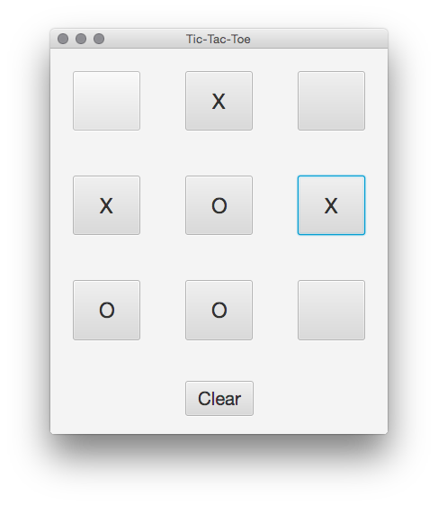

# TicTacToe
Tic-Tac-Toe game written in JavaFX, with a dark neon look.

## Features
- **vs AI** with three difficulty levels:
  - **Easy:** random moves
  - **Medium:** takes wins, blocks yours, likes the centre
  - **Hard:** minimax, can't be beaten
- **2 Players:** local hot-seat mode
- **Scoreboard:** wins and draws for the session
- **Animations:** marks pop in, the winning line glows and pulses, and the board shakes on a draw

## Run
Requires JDK 21. JavaFX is downloaded automatically by Gradle.

```
./gradlew run        # macOS / Linux
gradlew.bat run      # Windows
```


